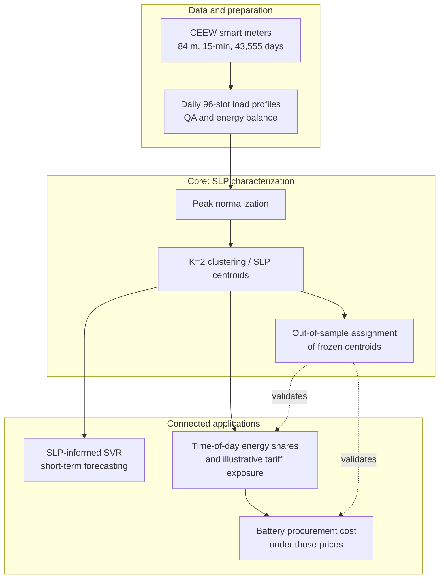

# Integrated research framework (SLP → applications)

Standard Load Profiles provide a **common descriptive foundation** for three connected uses of the same CEEW daily-profile pipeline.

## Research progression (conceptual)

1. **Heterogeneous consumption** — shape, magnitude, peaking, and time-of-day structure differ across meter-days.
2. **SLP characterization** — recurring pattern regimes (not verified consumer categories), including assignment of profiles from meters that did not form the centroids.
3. **SLP-informed forecasting** — a separate question: whether profile features change short-term error relative to persistence on the residential evaluation cohort.
4. **Tariff exposure** — the same shapes place different shares of energy in off-peak, shoulder, and peak price windows, so illustrative bills differ.
5. **Storage economics** — a battery can move purchases across those windows, but conversion loss, a cyclic state of charge, and the tested price spreads did not produce a lower procurement cost on the representative days. Peak reduction is not itself a bill saving when there is no demand charge.

## Distinctions (do not conflate)

| Layer | Question | Example evidence |
|-------|----------|------------------|
| Descriptive | Do the profiles separate patterns on unseen meters? | Held-out Cliff's δ for load factor ≈ 0.98 |
| Predictive | Do profile features lower forecast error? | Macro MAE ≈ 0.446 (SVR) vs 0.436 (persistence) |
| Tariff exposure | Do groups face different illustrative bills? | Peakier medoid about +18.6% versus a flat price |
| Storage procurement | Does storage cut energy cost? | No incremental saving on the medoids at 5 kWh / 2 kW |

Peak reduction under a peak-shaving objective does not by itself lower the energy bill when prices have no demand charge.