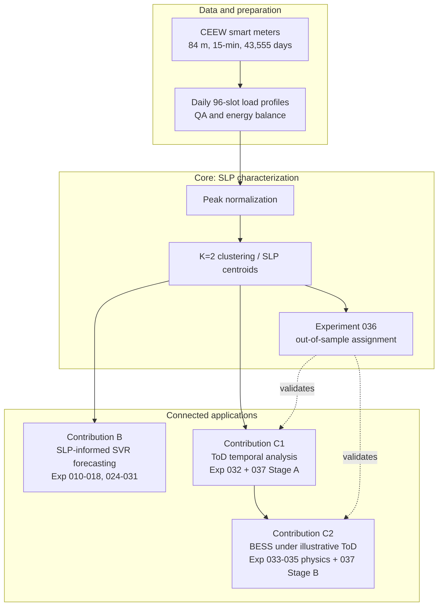

# Integrated research framework (SLP → applications)

Standard Load Profiles provide a **common descriptive foundation** for three connected uses of the same CEEW daily-profile pipeline.

## Research progression (conceptual)

1. **Heterogeneous consumption** — shape, magnitude, peaking, and time-of-day structure differ across meter-days.
2. **SLP characterization** — recurring pattern regimes (not verified consumer categories); validated out-of-sample (Exp 036).
3. **SLP-informed forecasting** — distinct question: predictive value of profile features (Norwegian evaluation; comparable MAE vs persistence).
4. **ToD tariff exposure** — same profiles imply different **energy shares** in off-peak / shoulder / peak periods → different illustrative bill impacts (Exp 037 Stage A).
5. **BESS economics** — storage may shift purchases across periods, but profit depends on spread, losses, constraints, and **energy-only** tariffs (Exp 037 Stage B; **no** positive savings on medoids under tested assumptions).

## Distinctions (do not conflate)

| Layer | Question | Example evidence |
|-------|----------|------------------|
| Descriptive | Do SLPs separate patterns? | Exp 036, Cliff's δ LF ≈ 0.98 |
| Predictive | Do SLP features improve SVR? | Exp 031 MAE ~0.446 vs 0.436 persistence |
| Tariff exposure | Do groups pay differently under ToD? | Exp 037: group 1 medoid +18.6% vs flat (illustrative) |
| BESS procurement | Does storage cut energy cost? | Exp 037: **₹0** incremental on medoids (moderate, 5 kWh/2 kW) |

Peak reduction from storage studies (Exp 035) does **not** automatically equal bill savings when **demand charges are absent** (Exp 037).