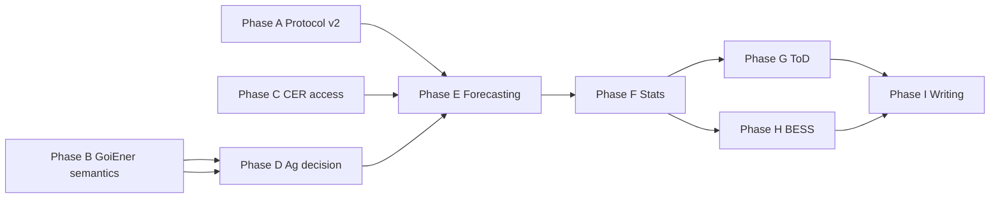

# Project completion roadmap

## Phases

### A — Protocol finalization (NOW)
- Outputs: this experiment's protocol docs.
- Gate: DEC-022 adopted.

### B — Data semantics (blocked external)
- Contact GoiEner / read codebook for `cons` + `flag`.
- Parallel with A.

### C — CER acquisition (**critical path** for residential)
- ISSDA request; audit on arrival.

### D — Agricultural expansion
- **NO-GO** until B + competency gate.

### E — Controlled forecasting
- Implement protocol v2 + SLP ablation design.

### F–I — Stats, ToD, BESS, writing
- Blocked on CER and units.

**Can run now:** A, literature review, CER application paperwork, CEEW supplementary writing.